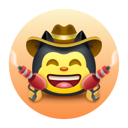
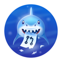
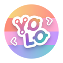
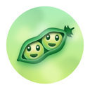
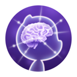
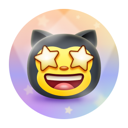
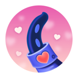
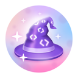
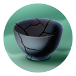

# GitHub Achievements Playground 🏆

[](https://github.com/NiraphatK/achievements-playground/actions/workflows/docs.yml)
[](LICENSE)

Every GitHub profile achievement, what earns it, and step-by-step instructions using both the web UI and the [GitHub CLI](https://cli.github.com/). Each step was tested in this repository, and the [live examples](#live-examples) link to the real issues, pull requests, and discussions.

**Language:** English | [ไทย](README.th.md)

## Contents

- [Quick reference](#quick-reference)
- [How to earn each achievement](#how-to-earn-each-achievement)
- [Live examples](#live-examples)
- [Troubleshooting](#troubleshooting)
- [Not earnable right now](#not-earnable-right-now)
- [Highlights](#highlights)
- [Play fair](#play-fair)
- [Sources and credits](#sources-and-credits)

## Quick reference

| Badge | Achievement | How to earn | Default | 🥉 Bronze | 🥈 Silver | 🥇 Gold |
| :---: | --- | --- | :---: | :---: | :---: | :---: |
|  | Quickdraw | Close an issue or pull request within 5 minutes of opening it | 1 | – | – | – |
|  | Pull Shark | Get pull requests you opened merged | 2 | 16 | 128 | 1024 |
|  | YOLO | Merge your own pull request without a code review | 1 | – | – | – |
|  | Pair Extraordinaire | Co-author a commit in a merged pull request | 1 | 10 | 24 | 48 |
|  | Galaxy Brain | Get answers in Discussions marked as accepted | 2 | 8 | 16 | 32 |
|  | Starstruck | Own a repository that receives stars | 16 | 128 | 512 | 4096 |
|  | Public Sponsor | Sponsor someone through GitHub Sponsors | 1 | – | – | – |

GitHub does not publish official criteria. The thresholds above match the community-maintained list in [Schweinepriester/github-profile-achievements](https://github.com/Schweinepriester/github-profile-achievements).

## How to earn each achievement

The CLI examples assume `gh auth login` is done and you are inside a clone of a repository you own.

### Quickdraw

Open an issue or a pull request and close it within 5 minutes.

1. Open the **Issues** tab and click **New issue**.
2. Enter any title and click **Create**.
3. Click **Close issue** right away.

```sh
url=$(gh issue create --title "Quickdraw practice" --body "Closing right away.")
gh issue close "$url"
```

You can also practice here with the [Quickdraw issue template](https://github.com/NiraphatK/achievements-playground/issues/new?template=quickdraw.yml).

### Pull Shark

You must be the author of the pull request. Pull requests merged into your own repository count.

```sh
git switch -c fix-readme-typo
# edit a file
git commit -am "Fix typo in README"
git push -u origin HEAD
gh pr create --fill
gh pr merge --merge --delete-branch
```

Repeat once more for the default badge.

### YOLO

Merge a pull request without waiting for a review. In this repository we asked a collaborator to review and then merged before they reviewed. Reports differ on whether the review request is required, so include one to be safe. Requesting a review requires at least one collaborator in the repository.

```sh
gh pr create --fill --reviewer <collaborator-login>
gh pr merge --merge --delete-branch
```

Do not merge without review in a repository where branch protection requires reviews. Only do this in your own repository.

### Pair Extraordinaire

Add a `Co-authored-by` trailer to a commit, then get the pull request that contains it merged. The trailer must be in the **commit message**, not in the pull request description, and the email must belong to the co-author's GitHub account.

Use the co-author's `noreply` address:

```sh
gh api users/<co-author-login> --jq '"\(.id)+\(.login)@users.noreply.github.com"'
```

Then commit with a blank line before the trailer:

```sh
git commit -m "Add setup notes" -m "Co-authored-by: Name <123456+login@users.noreply.github.com>"
```

Check that GitHub linked both accounts. The commit page should show two avatars. See [Creating a commit with multiple authors](https://docs.github.com/en/pull-requests/how-tos/commit-changes/creating-a-commit-with-multiple-authors).

> [!NOTE]
> Since around September 2026, many users report that this badge is not awarded even when the setup is correct. See [Troubleshooting](#troubleshooting).

### Galaxy Brain

Answer questions in the **Q&A** category of a repository's Discussions. The answer counts when the person who asked, or a maintainer, clicks **Mark as answer**.

- Answers in [GitHub Community discussions](https://github.com/orgs/community/discussions) no longer count since 2024-02-06 ([announcement](https://github.com/orgs/community/discussions/106536)).
- To enable Discussions in your own repository: **Settings → General → Features → Discussions**.

The most sustainable approach is to answer real questions in projects you already use.

### Starstruck

Own a repository that receives 16 stars. Build something useful, write a clear README, and share it. Do not buy or trade stars, because that breaks the [GitHub Acceptable Use Policies](https://docs.github.com/en/site-policy/acceptable-use-policies/github-acceptable-use-policies).

### Public Sponsor

Sponsor a developer or organization publicly through [GitHub Sponsors](https://github.com/sponsors). See the [GitHub Sponsors docs](https://docs.github.com/en/sponsors).

## Live examples

These are the issues, pull requests, and discussions from testing this repository.

| Achievement | Example | Result |
| --- | --- | --- |
| Quickdraw | [Issue #1](https://github.com/NiraphatK/achievements-playground/issues/1) | Awarded |
| Pull Shark | [PR #2](https://github.com/NiraphatK/achievements-playground/pull/2), [PR #3](https://github.com/NiraphatK/achievements-playground/pull/3) | Awarded |
| YOLO | [PR #3](https://github.com/NiraphatK/achievements-playground/pull/3): review requested, merged without review | Awarded |
| Galaxy Brain | [Discussion #4](https://github.com/NiraphatK/achievements-playground/discussions/4), [Discussion #5](https://github.com/NiraphatK/achievements-playground/discussions/5) | Awarded |
| Pair Extraordinaire | [PR #2](https://github.com/NiraphatK/achievements-playground/pull/2), [PR #6](https://github.com/NiraphatK/achievements-playground/pull/6): co-author linked correctly in both directions | Not awarded yet (known issue) |

## Troubleshooting

| Problem | What to check |
| --- | --- |
| No achievements show on your profile | Turn on **Show Achievements on my profile** in [Settings → Public profile](https://github.com/settings/profile). See [Managing visibility of achievements](https://docs.github.com/en/account-and-profile/how-tos/contribution-settings/manage-visibility-settings-for-private-contributions-and-achievements). |
| One achievement is missing, but others show up | Badges can take minutes to hours to appear. Check that the activity meets the criteria above. |
| Pair Extraordinaire is not awarded | Open the commit page and check that both avatars appear. If they do, this is a GitHub-side issue reported since around September 2026, for example [#212042](https://github.com/orgs/community/discussions/212042) and [#210202](https://github.com/orgs/community/discussions/210202). You can report it to [GitHub Support](https://support.github.com/). |
| Galaxy Brain is not awarded | Check that the answer was in the **Q&A** category (answerable) and not in GitHub Community discussions. |

## Not earnable right now

| Badge | Achievement | Status | How it was earned |
| :---: | --- | --- | --- |
|  | Heart On Your Sleeve | Being tested | React with ❤️ |
|  | Open Sourcerer | Being tested | Get pull requests merged in multiple public repositories |
|  | Finishing Touch | Limited | Authored a merged pull request that improved GitHub's UI quality |
|  | Arctic Code Vault Contributor | Retired | Contributed to a repository in the [2020 GitHub Archive Program](https://archiveprogram.github.com/) |
|  | Mars 2020 Contributor | Retired | Contributed to a repository used in the Mars 2020 Helicopter Mission |

## Highlights

Highlights are not achievements. They appear in the **Highlights** section of your profile.

| Highlight | How to get it |
| --- | --- |
| PRO | Subscribe to [GitHub Pro](https://docs.github.com/en/get-started/learning-about-github/githubs-plans) |
| Developer Program Member | Join the [GitHub Developer Program](https://docs.github.com/en/get-started/exploring-integrations/github-developer-program) |
| Security Bug Bounty Hunter | Report a valid vulnerability through the [GitHub Security Bug Bounty](https://bounty.github.com/) |
| GitHub Campus Expert | Join the [GitHub Campus Expert program](https://education.github.com/experts) |
| Security advisory credit | Get credited on an advisory in the [GitHub Advisory Database](https://github.com/advisories) |

See [Personalize your profile](https://docs.github.com/en/account-and-profile/tutorials/personalize-your-profile).

## Play fair

Achievements are meant to reflect real activity. Practicing in your own repository is fine. Do not spam other projects with pull requests or questions, and do not trade stars or answers. That behavior can get your account restricted under the [GitHub Acceptable Use Policies](https://docs.github.com/en/site-policy/acceptable-use-policies/github-acceptable-use-policies).

## Sources and credits

- Achievement data and badge images: [Schweinepriester/github-profile-achievements](https://github.com/Schweinepriester/github-profile-achievements) (MIT). The badge artwork belongs to GitHub, Inc.
- Additional references: [drknzz/GitHub-Achievements](https://github.com/drknzz/GitHub-Achievements) and [4xmen/Get-Github-Achievements](https://github.com/4xmen/Get-Github-Achievements).

## Contributing

Found something wrong or outdated? Open an [achievement correction](https://github.com/NiraphatK/achievements-playground/issues/new?template=correction.yml) issue or see [CONTRIBUTING.md](CONTRIBUTING.md). Ask questions in [Discussions](https://github.com/NiraphatK/achievements-playground/discussions/categories/q-a).

## License

The text in this repository is licensed under the [MIT License](LICENSE). The badge images belong to GitHub, Inc.
