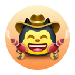
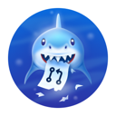
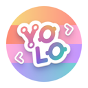
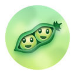
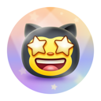
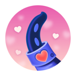
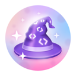
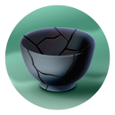

# GitHub Achievements Playground 🏆

[](https://github.com/NiraphatK/achievements-playground/actions/workflows/docs.yml)
[](LICENSE)

รวม achievement ทั้งหมดบนโปรไฟล์ GitHub ว่าแต่ละอันได้มายังไง พร้อมวิธีทำทีละขั้นทั้งผ่านหน้าเว็บและผ่าน [GitHub CLI](https://cli.github.com/) ทุกขั้นตอนลองทำจริงใน repo นี้แล้ว ดู issue, pull request และ discussion ที่ใช้ทดสอบได้ใน[ตัวอย่างจริง](#ตัวอย่างจริง)

**ภาษา:** [English](README.md) | ไทย

## สารบัญ

- [สรุปสั้น](#สรุปสั้น)
- [วิธีได้แต่ละ achievement](#วิธีได้แต่ละ-achievement)
- [ตัวอย่างจริง](#ตัวอย่างจริง)
- [แก้ปัญหา](#แก้ปัญหา)
- [ตอนนี้ยังได้ไม่ได้](#ตอนนี้ยังได้ไม่ได้)
- [Highlights](#highlights)
- [เล่นอย่างแฟร์](#เล่นอย่างแฟร์)
- [แหล่งข้อมูลและเครดิต](#แหล่งข้อมูลและเครดิต)

## สรุปสั้น

| Badge | Achievement | วิธีได้ | ปกติ | 🥉 ทองแดง | 🥈 เงิน | 🥇 ทอง |
| :---: | --- | --- | :---: | :---: | :---: | :---: |
|  | Quickdraw | ปิด issue หรือ pull request ภายใน 5 นาทีหลังเปิด | 1 | – | – | – |
|  | Pull Shark | pull request ที่เราเปิดถูก merge | 2 | 16 | 128 | 1024 |
|  | YOLO | merge pull request ของตัวเองโดยไม่มีใคร review | 1 | – | – | – |
|  | Pair Extraordinaire | เป็น co-author ของคอมมิตใน pull request ที่ถูก merge | 1 | 10 | 24 | 48 |
|  | Galaxy Brain | คำตอบใน Discussions ถูกเลือกเป็นคำตอบที่ถูกต้อง | 2 | 8 | 16 | 32 |
|  | Starstruck | มี repo ของตัวเองที่มีคนกดดาว | 16 | 128 | 512 | 4096 |
|  | Public Sponsor | สปอนเซอร์ใครก็ได้ผ่าน GitHub Sponsors | 1 | – | – | – |

GitHub ไม่ได้ประกาศเกณฑ์อย่างเป็นทางการ ตัวเลขข้างบนอ้างอิงจากรายการที่ชุมชนดูแลใน [Schweinepriester/github-profile-achievements](https://github.com/Schweinepriester/github-profile-achievements)

## วิธีได้แต่ละ achievement

ตัวอย่างคำสั่ง CLI สมมติว่ารัน `gh auth login` แล้ว และอยู่ในโฟลเดอร์ที่ clone repo ของตัวเองมา

### Quickdraw

เปิด issue หรือ pull request แล้วปิดภายใน 5 นาที

1. ไปที่แท็บ **Issues** แล้วกด **New issue**
2. ใส่ชื่ออะไรก็ได้แล้วกด **Create**
3. กด **Close issue** ทันที

```sh
url=$(gh issue create --title "Quickdraw practice" --body "Closing right away.")
gh issue close "$url"
```

ลองทำใน repo นี้ก็ได้ ใช้ [template ของ Quickdraw](https://github.com/NiraphatK/achievements-playground/issues/new?template=quickdraw.yml)

### Pull Shark

เราต้องเป็นคนเปิด pull request เอง pull request ที่ merge เข้า repo ของตัวเองก็นับ

```sh
git switch -c fix-readme-typo
# แก้ไฟล์
git commit -am "Fix typo in README"
git push -u origin HEAD
gh pr create --fill
gh pr merge --merge --delete-branch
```

ทำอีกรอบเพื่อให้ได้ badge แรก

### YOLO

merge pull request โดยไม่รอให้ใคร review ตอนทดสอบใน repo นี้เราขอให้ collaborator review แล้ว merge เลยก่อนเขาจะ review แต่ละแหล่งบอกไม่ตรงกันว่าต้องขอ review ก่อนหรือเปล่า ขอไว้ก่อนจะชัวร์กว่า การขอ review ต้องมี collaborator ใน repo อย่างน้อย 1 คน

```sh
gh pr create --fill --reviewer <collaborator-login>
gh pr merge --merge --delete-branch
```

อย่า merge โดยไม่ review ใน repo ที่ตั้ง branch protection ให้ต้อง review ทำแบบนี้แค่ใน repo ของตัวเองเท่านั้น

### Pair Extraordinaire

ใส่ `Co-authored-by` ไว้ท้ายข้อความคอมมิต แล้วให้ pull request ที่มีคอมมิตนั้นถูก merge บรรทัดนี้ต้องอยู่ใน**ข้อความคอมมิต** ไม่ใช่ในคำอธิบาย pull request และอีเมลต้องเป็นของบัญชี GitHub ของ co-author

ใช้อีเมล `noreply` ของ co-author:

```sh
gh api users/<co-author-login> --jq '"\(.id)+\(.login)@users.noreply.github.com"'
```

แล้วคอมมิตโดยเว้นบรรทัดว่างก่อน trailer:

```sh
git commit -m "Add setup notes" -m "Co-authored-by: Name <123456+login@users.noreply.github.com>"
```

เช็คว่า GitHub ผูกกับบัญชีถูกต้อง หน้าคอมมิตควรขึ้นรูปโปรไฟล์ 2 คน ดูเพิ่มที่ [Creating a commit with multiple authors](https://docs.github.com/en/pull-requests/how-tos/commit-changes/creating-a-commit-with-multiple-authors)

> [!NOTE]
> ตั้งแต่ประมาณกันยายน 2026 มีหลายคนรายงานว่าทำถูกทุกอย่างแต่ไม่ได้ badge นี้ ดูที่[แก้ปัญหา](#แก้ปัญหา)

### Galaxy Brain

ตอบคำถามในหมวด **Q&A** ของ Discussions ใน repo ไหนก็ได้ คำตอบจะนับเมื่อคนถามหรือ maintainer กด **Mark as answer**

- ตั้งแต่ 2024-02-06 คำตอบใน [GitHub Community discussions](https://github.com/orgs/community/discussions) ไม่นับแล้ว ([ประกาศ](https://github.com/orgs/community/discussions/106536))
- วิธีเปิด Discussions ใน repo ของตัวเอง: **Settings → General → Features → Discussions**

ทางที่ยั่งยืนที่สุดคือตอบคำถามจริงในโปรเจกต์ที่เราใช้อยู่แล้ว

### Starstruck

มี repo ของตัวเองที่มีคนกดดาว 16 ดวง ทำของที่มีประโยชน์ เขียน README ให้ชัด แล้วแชร์ อย่าซื้อหรือแลกดาว เพราะผิด [GitHub Acceptable Use Policies](https://docs.github.com/en/site-policy/acceptable-use-policies/github-acceptable-use-policies)

### Public Sponsor

สปอนเซอร์นักพัฒนาหรือองค์กรแบบเปิดเผยผ่าน [GitHub Sponsors](https://github.com/sponsors) ดูเพิ่มที่ [GitHub Sponsors docs](https://docs.github.com/en/sponsors)

## ตัวอย่างจริง

issue, pull request และ discussion ที่ใช้ทดสอบใน repo นี้

| Achievement | ตัวอย่าง | ผล |
| --- | --- | --- |
| Quickdraw | [Issue #1](https://github.com/NiraphatK/achievements-playground/issues/1) | ได้แล้ว |
| Pull Shark | [PR #2](https://github.com/NiraphatK/achievements-playground/pull/2), [PR #3](https://github.com/NiraphatK/achievements-playground/pull/3) | ได้แล้ว |
| YOLO | [PR #3](https://github.com/NiraphatK/achievements-playground/pull/3): ขอ review แล้ว merge โดยไม่มี review | ได้แล้ว |
| Galaxy Brain | [Discussion #4](https://github.com/NiraphatK/achievements-playground/discussions/4), [Discussion #5](https://github.com/NiraphatK/achievements-playground/discussions/5) | ได้แล้ว |
| Pair Extraordinaire | [PR #2](https://github.com/NiraphatK/achievements-playground/pull/2), [PR #6](https://github.com/NiraphatK/achievements-playground/pull/6): GitHub ผูก co-author กับบัญชีถูกต้องทั้งสองทาง | ยังไม่ได้ (ปัญหาที่รู้กันอยู่) |

## แก้ปัญหา

| ปัญหา | สิ่งที่ต้องเช็ค |
| --- | --- |
| ไม่มี achievement ขึ้นในโปรไฟล์เลย | เปิด **Show Achievements on my profile** ใน [Settings → Public profile](https://github.com/settings/profile) ดูเพิ่มที่ [Managing visibility of achievements](https://docs.github.com/en/account-and-profile/how-tos/contribution-settings/manage-visibility-settings-for-private-contributions-and-achievements) |
| ขาดไปอันเดียว แต่อันอื่นขึ้นปกติ | badge อาจใช้เวลาเป็นนาทีหรือเป็นชั่วโมงกว่าจะขึ้น เช็คว่าทำครบตามเกณฑ์ข้างบนหรือยัง |
| ไม่ได้ Pair Extraordinaire | เปิดหน้าคอมมิตแล้วดูว่าขึ้นรูปโปรไฟล์ทั้งสองคนไหม ถ้าขึ้น แปลว่าเป็นปัญหาฝั่ง GitHub ที่มีคนรายงานตั้งแต่ประมาณกันยายน 2026 เช่น [#212042](https://github.com/orgs/community/discussions/212042) และ [#210202](https://github.com/orgs/community/discussions/210202) แจ้ง [GitHub Support](https://support.github.com/) ได้ |
| ไม่ได้ Galaxy Brain | เช็คว่าตอบในหมวด **Q&A** (หมวดที่เลือกคำตอบได้) และไม่ได้ตอบใน GitHub Community discussions |

## ตอนนี้ยังได้ไม่ได้

| Badge | Achievement | สถานะ | เคยได้มายังไง |
| :---: | --- | --- | --- |
|  | Heart On Your Sleeve | กำลังทดสอบ | รีแอค ❤️ |
|  | Open Sourcerer | กำลังทดสอบ | pull request ถูก merge ในหลาย public repo |
|  | Finishing Touch | ได้เฉพาะบางกรณี | เป็นคนเขียน pull request ที่ช่วยปรับคุณภาพ UI ของ GitHub แล้วถูก merge |
|  | Arctic Code Vault Contributor | เลิกแจกแล้ว | มีส่วนร่วมใน repo ที่อยู่ใน [2020 GitHub Archive Program](https://archiveprogram.github.com/) |
|  | Mars 2020 Contributor | เลิกแจกแล้ว | มีส่วนร่วมใน repo ที่ใช้ในภารกิจ Mars 2020 Helicopter |

## Highlights

Highlights ไม่ใช่ achievement แต่จะขึ้นในส่วน **Highlights** ของโปรไฟล์

| Highlight | วิธีได้ |
| --- | --- |
| PRO | สมัคร [GitHub Pro](https://docs.github.com/en/get-started/learning-about-github/githubs-plans) |
| Developer Program Member | เข้าร่วม [GitHub Developer Program](https://docs.github.com/en/get-started/exploring-integrations/github-developer-program) |
| Security Bug Bounty Hunter | รายงานช่องโหว่ที่ใช้ได้จริงผ่าน [GitHub Security Bug Bounty](https://bounty.github.com/) |
| GitHub Campus Expert | เข้าร่วม [GitHub Campus Expert program](https://education.github.com/experts) |
| Security advisory credit | ได้เครดิตใน advisory ของ [GitHub Advisory Database](https://github.com/advisories) |

ดูเพิ่มที่ [Personalize your profile](https://docs.github.com/en/account-and-profile/tutorials/personalize-your-profile)

## เล่นอย่างแฟร์

achievement ควรสะท้อนกิจกรรมจริง ฝึกใน repo ของตัวเองได้ แต่อย่าสแปม pull request หรือคำถามในโปรเจกต์ของคนอื่น และอย่าแลกดาวหรือแลกคำตอบกัน เพราะอาจโดนจำกัดบัญชีตาม [GitHub Acceptable Use Policies](https://docs.github.com/en/site-policy/acceptable-use-policies/github-acceptable-use-policies)

## แหล่งข้อมูลและเครดิต

- ข้อมูล achievement และรูป badge: [Schweinepriester/github-profile-achievements](https://github.com/Schweinepriester/github-profile-achievements) (MIT) ลิขสิทธิ์ของรูป badge เป็นของ GitHub, Inc.
- แหล่งอ้างอิงเพิ่มเติม: [drknzz/GitHub-Achievements](https://github.com/drknzz/GitHub-Achievements) และ [4xmen/Get-Github-Achievements](https://github.com/4xmen/Get-Github-Achievements)

## ร่วมพัฒนา

เจอข้อมูลผิดหรือเก่า? เปิด issue แบบ [achievement correction](https://github.com/NiraphatK/achievements-playground/issues/new?template=correction.yml) หรืออ่าน [CONTRIBUTING.md](CONTRIBUTING.md) มีคำถามถามได้ที่ [Discussions](https://github.com/NiraphatK/achievements-playground/discussions/categories/q-a)

## License

เนื้อหาใน repo นี้ใช้ [MIT License](LICENSE) ลิขสิทธิ์ของรูป badge เป็นของ GitHub, Inc.
